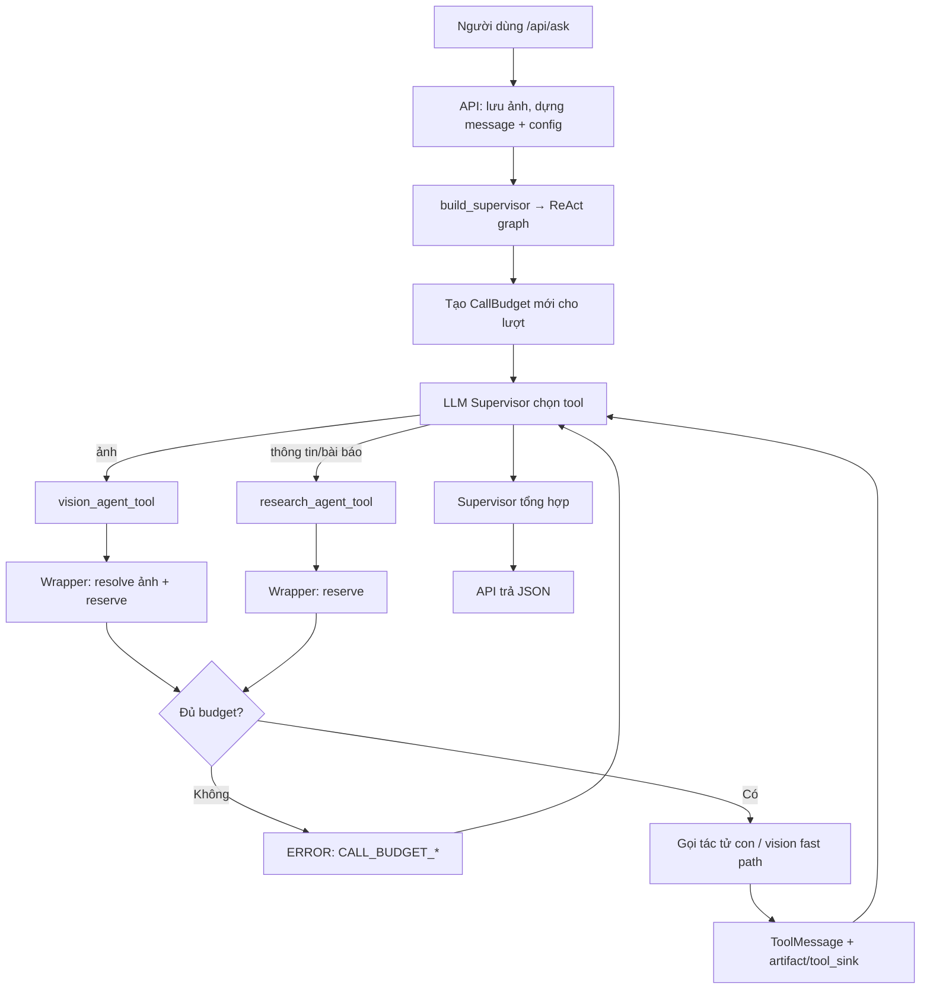

TIẾN ĐỘ: Pha 9/9 hoàn tất

## 0. Phạm vi

- Commit khảo sát: `a59f4fe` (`git rev-parse --short HEAD`); nhánh `14/10`.
- Lưu ý: nội dung được đọc từ worktree hiện tại; lúc khảo sát nhiều file lõi/README đã có sửa đổi chưa commit. Git log bên dưới là lịch sử commit, không chứng minh các sửa đổi đang có trong worktree đã nằm trong commit nào.
- Phạm vi supervisor và số dòng hiện có:
  - `app/agents/supervisor/agent.py` — 94 dòng
  - `app/agents/supervisor/tools.py` — 421 dòng
  - `app/agents/supervisor/prompts.py` — 70 dòng
  - `app/agents/supervisor/budget.py` — 88 dòng
  - `app/agents/supervisor/__init__.py` — 12 dòng
  - `app/agents/__init__.py` — 58 dòng
- File đọc để hiểu luồng:
  - `app/api.py` — 1145 dòng
  - `app/core/contracts.py` — 115 dòng
  - `app/core/config.py` — 473 dòng
  - `streamlit_app.py` — 110 dòng
  - `app/main.py` — 243 dòng
- Test trong phạm vi:
  - `tests/test_supervisor_budget.py` — 231 dòng
  - `tests/test_supervisor_rong.py` — không tìm thấy
  - `tests/test_agents_e2e.py` — 157 dòng
  - `tests/test_agent_trace.py` — 223 dòng
  - `tests/test_contract.py` — 111 dòng
- `README.md` — 363 dòng; chỉ đọc phần mô tả luồng supervisor.
- Ghi chú: `tests/test_supervisor_rong.py` hiện không tồn tại; các con số là trạng thái tại commit khảo sát.

## 1. Bản đồ file

| File lõi | Vai trò (nói đơn giản) |
|---|---|
| `app/agents/supervisor/agent.py` | Dựng graph Supervisor bằng ReAct, chọn bộ tool và bọc graph để mỗi lượt có ngân sách riêng. |
| `app/agents/supervisor/tools.py` | Định nghĩa hai tool Supervisor dùng để gọi tác tử con; kiểm hạn mức, quản lý lỗi/retry, chuyển kết quả và bí danh ảnh. |
| `app/agents/supervisor/prompts.py` | Chứa quy tắc điều phối, cách dùng tool, ngôn ngữ/trích dẫn và xử lý ảnh trong prompt. |
| `app/agents/supervisor/budget.py` | Đếm lượt gọi theo agent và tổng; đồng bộ phép giữ lượt bằng `Lock`. |
| `app/agents/supervisor/__init__.py` | Xuất API công khai `build_supervisor`, tên Supervisor và prompt. |
| `app/agents/__init__.py` | Registry mô tả tác tử con; sinh danh mục được chèn vào prompt. |

### Hàm/Class, luồng gọi

| Hàm/Class | Dòng | Làm gì | Gọi bởi / gọi tới |
|---|---:|---|---|
| `_wrap_agent_to_tool` | `app/agents/supervisor/agent.py:19-25` | Giữ nguyên `BaseTool`, nếu không thì bọc agent thành tool `transfer_to_<name>`. | `build_supervisor`; gọi `make_sub_agent_tool`. |
| `_InvocationBudgetGraph` | `app/agents/supervisor/agent.py:28-60` | Proxy các kiểu chạy graph và thêm `CallBudget` vào config từng lần chạy. | Được tạo bởi `build_supervisor`; chuyển tiếp `invoke`/`ainvoke`/`stream`/`astream` tới graph thật. |
| `build_supervisor` | `app/agents/supervisor/agent.py:63-94` | Dựng graph `create_react_agent` với model, tools và prompt. | API, CLI, Streamlit và test; gọi `agent_catalog`, lấy `SUPERVISOR_TOOLS`, trả proxy graph. |
| `CallBudget` | `app/agents/supervisor/budget.py:13-73` | Giữ bộ đếm từng agent/tổng; `reserve` trả được phép hay lý do từ chối. | Wrapper tool qua `budget_from_config`; gọi `from_settings`. |
| `budget_from_config` | `app/agents/supervisor/budget.py:75-85` | Tái dùng budget trong `configurable`, hoặc tạo budget cho lượt tool độc lập. | `tools.py:_giu_ngan_sach`; gọi `CallBudget.from_settings`. |
| `get_research_agent` | `app/agents/supervisor/tools.py:66-84` | Tái dùng instance tác tử con; có cache theo chế độ research. | `research_tool`; khởi tạo tác tử con. |
| `get_vision_agent`, `reset_sub_agent_instances` | `app/agents/supervisor/tools.py:87-100` | Tái dùng/reset cache instance tác tử con. | `vision_tool`, test/fixture. |
| `_loi_agent`, `_la_loi_tam_thoi`, `_giu_ngan_sach` | `app/agents/supervisor/tools.py:103-140` | Chuẩn hóa lỗi, phân loại lỗi tạm thời, và biến budget từ chối thành mã lỗi. | `_chay_agent_con`, hai tool công khai; gọi `tool_error`/`CallBudget.reserve`. |
| `_invoke_agent` | `app/agents/supervisor/tools.py:142-155` | Kiểm tra signature để truyền `config` nếu `invoke` hỗ trợ. | `_chay_agent_con`; dùng `inspect.signature`. |
| `_chay_agent_con` | `app/agents/supervisor/tools.py:158-240` | Gọi agent con, retry lỗi tạm thời, kiểm state và tách câu trả lời/artifact. | Hai tool mặc định và tool bọc động. |
| `so_bi_danh`, `chon_chu_de_cho_anh`, `giai_bi_danh_anh` | `app/agents/supervisor/tools.py:243-262`, `307-331` | Nhận diện IMG<n>, chọn chủ đề ảnh, giải mã ID sang file qua config. | `vision_tool`; có thể gọi resolver trong `configurable`. |
| `chuyen_ket_qua_tool_con` | `app/agents/supervisor/tools.py:265-282` | Đẩy nội dung tool lồng bên trong ra `tool_sink` cho tầng gọi. | `_chay_agent_con`; đọc `configurable.tool_sink`. |
| `thu_tra_loi_truc_tiep` | `app/agents/supervisor/tools.py:285-304` | Thử đường đọc ảnh trực tiếp; trả `None` để fallback nếu không áp dụng/lỗi. | `vision_tool`; không thay thế cơ chế gọi tool con. |
| `research_tool`, `vision_tool` | `app/agents/supervisor/tools.py:334-353`, `356-395` | Hai tool cố định gọi tác tử con tương ứng; cả hai kiểm ngân sách. | LLM Supervisor; gọi cache, `_chay_agent_con` hoặc đường vision trực tiếp. |
| `make_sub_agent_tool` | `app/agents/supervisor/tools.py:398-417` | Tạo tool động cho agent không phải `BaseTool`. | `_wrap_agent_to_tool`; gọi `_chay_agent_con`. |
| `AgentSpec`, `validate_*` | `app/core/contracts.py:29-64`, `66-94` | Mô tả agent, kiểm tên/description/factory bằng `inspect.signature`; kiểm hợp đồng tool và bố cục package. | Registry/test hợp đồng. |
| `build_all_agents`, `agent_catalog` | `app/agents/__init__.py:41-48` | Dựng toàn bộ theo registry hoặc tạo các dòng danh mục tên+mô tả. | `agent_catalog` được gọi khi dựng prompt; `build_all_agents` không được gọi bởi đường mặc định trong `build_supervisor`. |

### Hằng số và biến cấp module đáng nhớ

| Tên | Dòng | Ý nghĩa |
|---|---:|---|
| `SUPERVISOR_NAME` | `app/agents/supervisor/agent.py:16` | Tên cố định `"supervisor"`. |
| `CALL_BUDGET_CONFIG_KEY`, `_LOGGER` | `app/agents/supervisor/budget.py:8-10` | Khóa `"supervisor_call_budget"` trong `configurable`; logger. |
| `_RETRY_BACKOFF_SECONDS`, `_TRANSIENT_ERROR_NAMES` | `app/agents/supervisor/tools.py:23-47` | Backoff 0,1 giây; tập tên exception tạm thời cho whitelist. |
| `_BI_DANH_RE`, `_CHI_SO_RE` | `app/agents/supervisor/tools.py:52-56` | Regex nhận dạng bí danh ảnh và số ảnh. |
| `_research_agent_instance`, `_vision_agent_instance`, `_research_agent_theo_che_do` | `app/agents/supervisor/tools.py:59-63` | Cache instance; cache theo mode chỉ áp dụng cho research topics. Không có `Lock` ở chỗ khởi tạo cache. |
| `SUPERVISOR_TOOLS` | `app/agents/supervisor/tools.py:420-421` | Danh sách mặc định cố định gồm `research_tool`, `vision_tool`. |
| `AGENT_SPECS`, `AGENT_SPECS_BY_NAME` | `app/agents/__init__.py:32-38` | Registry hai tác tử con và map tra theo tên. |
| `recursion_limit`, ngưỡng budget | `app/core/config.py:244-250` | Mặc định recursion 50; 3 lượt/agent, 6 lượt tổng; tên env trong mục 5. |

### Trích đoạn then chốt

`app/agents/supervisor/agent.py:34-43`
```python
    @staticmethod
    def _config(config: dict | None) -> dict:
        run_config = dict(config or {})
        configurable = dict(run_config.get("configurable") or {})
        configurable[CALL_BUDGET_CONFIG_KEY] = CallBudget.from_settings()
        run_config["configurable"] = configurable
        return run_config

    def invoke(self, input: Any, config: dict | None = None, **kwargs: Any) -> Any:
        return self._graph.invoke(input, config=self._config(config), **kwargs)
```

`app/agents/supervisor/tools.py:334-343`
```python
@tool("research_agent_tool", response_format="content_and_artifact")
def research_tool(query: str, config: RunnableConfig = None):
    """Use for ANY information question: scientific papers (arXiv, OpenAlex...), explanations
    of concepts (Wikipedia), and recent news, interviews or events (news search).
    Input should be a clear, self-contained question.
    """
    mode = ((config or {}).get("configurable") or {}).get("research_mode")
    budget_error = _giu_ngan_sach("research_agent", config)
    if budget_error:
        return budget_error, {}
    try:
```

`app/agents/supervisor/prompts.py:6-14`
```text
RULES:
- You have access to tools (`research_agent_tool` and `vision_agent_tool`). Use them to gather information when needed.
- Call tools one by one if multiple tools are required, then combine their results into a final response.
- Call a tool ONLY ONCE if the retrieved result is sufficient to answer the user request. Do not repeat identical tool calls.
- Do NOT make up information — rely strictly on the outputs returned by the tools.
- ANY question asking for information, knowledge or events MUST go through
  `research_agent_tool` first. Answer by yourself ONLY for greetings or small talk.
- This includes NEWS, interviews, statements of public figures and recent events:
  `research_agent_tool` has a news source, so pass such questions to it too (keep names and
```

`app/agents/supervisor/budget.py:33-43`
```python
    def reserve(self, agent_name: str) -> tuple[bool, str, int, int]:
        """Giữ một lượt gọi hoặc trả lý do vượt giới hạn."""
        with self._lock:
            agent_calls = self._calls_by_agent.get(agent_name, 0)
            if agent_calls >= self.max_calls_per_agent:
                reason = "agent"
            elif self._total_calls >= self.max_total_calls:
                reason = "total"
            else:
                agent_calls += 1
                self._total_calls += 1
                self._calls_by_agent[agent_name] = agent_calls
```

`app/agents/supervisor/__init__.py:1-7`
```python
"""Gói Supervisor — TOÀN BỘ code điều phối nằm trong thư mục này.

    agent.py    build_supervisor()
    prompts.py  SUPERVISOR_PROMPT_TEMPLATE

Chủ sở hữu: người phụ trách Supervisor Agent.
"""
```

`app/agents/__init__.py:32-40`
```python
AGENT_SPECS: List[AgentSpec] = [
    AgentSpec(RESEARCH_NAME, RESEARCH_DESCRIPTION, build_research_agent),
    AgentSpec(VISION_NAME, VISION_DESCRIPTION, build_vision_agent),
    # AgentSpec(CODE_NAME, CODE_DESCRIPTION, build_code_agent),   # <- agent thứ 3 thêm ở đây
]

AGENT_SPECS_BY_NAME: Dict[str, AgentSpec] = {s.name: s for s in AGENT_SPECS}
```

## 2. Kỹ thuật dùng trong Supervisor

### 2.1 ReAct để Supervisor chọn tool

- **Một câu nói với giảng viên:** Supervisor dùng `create_react_agent` để đọc yêu cầu, chọn tool thích hợp, xem kết quả rồi mới trả lời.
- **Ví dụ đời thường:** Người điều phối xem yêu cầu, gọi đúng bộ phận, nhận báo cáo rồi tổng hợp.
- **Lý thuyết nền:** ReAct kết hợp suy luận với hành động qua tool. LLM phát ra tool call có tên và tham số; runtime chạy tool và đưa observation về lại graph. Supervisor có thể gọi tool thêm lượt trước khi trả lời cuối. Prompt giới hạn một tool call khi kết quả đã đủ nhưng không thay cho giới hạn cứng.
- **Code ở đâu:** `app/agents/supervisor/agent.py:86-94`
```python
    if prompt is None:
        prompt = SUPERVISOR_PROMPT_TEMPLATE.format(agent_catalog=agent_catalog())

    graph = create_react_agent(
        model=model,
        tools=tools,
        prompt=prompt,
    )
    return _InvocationBudgetGraph(graph)
```
- **Chạy lúc nào trong luồng:** Khi dựng graph, và mỗi lượt người dùng cần chọn tool hoặc trả lời trực tiếp.
- **Trade-off/hạn chế:** LLM vẫn có thể chọn sai tool hoặc gọi dư; prompt chỉ hướng dẫn, còn budget mới chặn số lần gọi.
- **Test bảo vệ:** `tests/test_agents_e2e.py::test_supervisor_route_sang_research_agent`, `tests/test_agents_e2e.py::test_supervisor_route_lan_luot_hai_agent`.
- **Câu giảng viên hay hỏi + trả lời mẫu:** *ReAct có phải agent con không?* Không; đây là cách graph Supervisor ra quyết định gọi tool rồi tiếp tục từ kết quả trả về.

### 2.2 Supervisor-as-tools và bọc agent

- **Một câu nói với giảng viên:** Supervisor gọi tác tử con như tool, nhận kết quả và tự giữ quyền điều phối thay vì chuyển quyền điều khiển qua handoff.
- **Ví dụ đời thường:** Tổng đài viên gọi chuyên viên, nghe tư vấn rồi tiếp tục làm đầu mối.
- **Lý thuyết nền:** Tool wrapper tạo giao diện thống nhất cho graph agent. Tên tool và schema được cung cấp cho model; adapter đóng gói input, gọi `invoke`, rồi lấy câu trả lời. Code vẫn giữ adapter tên `transfer_to_*` cho đường truyền `agents=[...]` tương thích test cũ, nhưng đường chạy mặc định dùng hai tool tên khác.
- **Code ở đâu:** `app/agents/supervisor/agent.py:76-91`
```python
    if tools is None:
        if agents is not None:
            tools = [_wrap_agent_to_tool(a) for a in agents]
        else:
            tools = SUPERVISOR_TOOLS
    else:
        tools = [_wrap_agent_to_tool(t) for t in tools]

    if prompt is None:
        prompt = SUPERVISOR_PROMPT_TEMPLATE.format(agent_catalog=agent_catalog())
    graph = create_react_agent(
        model=model,
        tools=tools,
```
- **Chạy lúc nào trong luồng:** Khi dựng graph; mỗi tool call chạy adapter rồi trả observation cho Supervisor.
- **Trade-off/hạn chế:** Không có handoff làm quyền điều khiển dễ hiểu hơn, nhưng tool mặc định hiện được liệt kê thủ công, không tự sinh từ mọi `AgentSpec`.
- **Test bảo vệ:** `tests/test_agents_e2e.py::test_supervisor_route_lan_luot_hai_agent`, `tests/test_supervisor_budget.py::test_prompt_chi_nhac_ten_tool_da_dang_ky`.
- **Câu giảng viên hay hỏi + trả lời mẫu:** *Vì sao không handoff?* Supervisor-as-tool giữ một vòng điều phối và trả kết quả con về làm observation; README vẫn mô tả handoff nên phần tài liệu đó đã cũ so với mặc định.

### 2.3 `content_and_artifact` và tách nội dung với metadata

- **Một câu nói với giảng viên:** Tool trả nội dung cho LLM và artifact riêng cho ứng dụng để Supervisor không phải đọc toàn bộ dữ liệu phụ.
- **Ví dụ đời thường:** Chuyên viên gửi một câu kết luận cho người điều phối và đính kèm hồ sơ chi tiết cho bộ phận lưu trữ.
- **Lý thuyết nền:** Tool có thể trả về hai kênh: content làm kết quả trao đổi của agent, artifact là dữ liệu phụ có cấu trúc. `_chay_agent_con` gom tool outputs, evidence, topics và grounding vào artifact. API nhận kết quả tool bên trong qua `tool_sink`; không nên nhầm artifact với phần văn bản mà LLM đang tổng hợp.
- **Code ở đâu:** `app/agents/supervisor/tools.py:164-169`, `234-240`
```python
    """Chạy agent con, trả (câu trả lời cuối, artifact cho web UI).

    artifact KHÔNG gửi cho LLM của supervisor (response_format="content_and_artifact"),
    chỉ nằm trong ToolMessage.artifact để app/api.py đọc: kết quả tool bên trong
    agent con (ảnh khoanh vùng của YOLO...), các agent chủ đề đã chạy, bằng chứng.
    Không có lớp này thì supervisor-as-tool "nuốt" hết, UI chỉ thấy câu trả lời trần.
    """
    from app.core.pretty import message_text
```
- **Chạy lúc nào trong luồng:** Sau khi agent con trả state; decorator của hai tool mặc định định dạng phần content/artifact.
- **Trade-off/hạn chế:** Artifact không tự trở thành câu trả lời cho model; ứng dụng phải đọc/ghép đúng chỗ. Hai test chính trong danh sách được yêu cầu không kiểm tra đầy đủ schema của artifact.
- **Test bảo vệ:** Gần nhất trong phạm vi là `tests/test_agent_trace.py::test_goi_vision_thi_giao_dien_biet_vision_da_lam_viec`; **Chưa xác định** test trong danh sách yêu cầu khẳng định toàn bộ trường artifact.
- **Câu giảng viên hay hỏi + trả lời mẫu:** *Artifact có được Supervisor dùng để suy luận không?* Không theo docstring và hợp đồng `content_and_artifact`; nội dung text mới là observation cho model.

### 2.4 Truyền `RunnableConfig` xuống graph con

- **Một câu nói với giảng viên:** Config của lượt chạy được chuyển tiếp xuống agent con nếu signature của `invoke` hỗ trợ tham số đó.
- **Ví dụ đời thường:** Khi chuyển việc, gửi kèm số hồ sơ và hướng dẫn chung nếu người nhận có chỗ nhận các thông tin đó.
- **Lý thuyết nền:** `RunnableConfig` thường mang recursion limit và `configurable` metadata. `_invoke_agent` dùng reflection để tương thích các fake/agent có signature cũ. `config` được chuyển nguyên trạng, không lọc tiền tố nội bộ; khẳng định lọc `_pregel_` hay `checkpoint_` không đúng với code đang đọc.
- **Code ở đâu:** `app/agents/supervisor/tools.py:142-155`
```python
def _invoke_agent(agent, state: dict, config: dict | None):
    invoke = agent.invoke
    try:
        parameters = inspect.signature(invoke).parameters.values()
    except (TypeError, ValueError):
        return invoke(state, config=config)
    if any(
        parameter.name == "config"
        or parameter.kind is inspect.Parameter.VAR_KEYWORD
        for parameter in parameters
    ):
        return invoke(state, config=config)
    return invoke(state)
```
- **Chạy lúc nào trong luồng:** Trong wrapper khi gọi `agent.invoke`.
- **Trade-off/hạn chế:** Giữ tương thích signature, nhưng config được chuyển tiếp không chọn lọc; trường nội bộ có thể đi xuống graph con.
- **Test bảo vệ:** `tests/test_supervisor_budget.py::test_agent_con_nhan_config_tu_supervisor_graph`.
- **Câu giảng viên hay hỏi + trả lời mẫu:** *Có bỏ `_pregel_` trước khi truyền không?* Không thấy bước lọc; test còn xác nhận giữ `recursion_limit` và `trace_marker`.

### 2.5 Budget riêng theo lượt Supervisor

- **Một câu nói với giảng viên:** Mỗi lần graph Supervisor chạy nhận một `CallBudget` mới, có trần từng agent và trần toàn lượt.
- **Ví dụ đời thường:** Mỗi khách hàng bắt đầu một phiếu có số lượt tư vấn tối đa riêng.
- **Lý thuyết nền:** `_InvocationBudgetGraph._config` sao chép config và `configurable`, rồi gắn budget mới trước mỗi kiểu gọi graph. Các tool dùng chung object đó qua config để đếm cùng lượt. Giới hạn được lấy từ `Settings`, mặc định 3/agent và 6/tổng; giới hạn không tự cộng dồn giữa các lượt người dùng.
- **Code ở đâu:** `app/agents/supervisor/agent.py:34-43`
```python
    @staticmethod
    def _config(config: dict | None) -> dict:
        run_config = dict(config or {})
        configurable = dict(run_config.get("configurable") or {})
        configurable[CALL_BUDGET_CONFIG_KEY] = CallBudget.from_settings()
        run_config["configurable"] = configurable
        return run_config

    def invoke(self, input: Any, config: dict | None = None, **kwargs: Any) -> Any:
        return self._graph.invoke(input, config=self._config(config), **kwargs)
```
- **Chạy lúc nào trong luồng:** Ngay khi gọi `invoke`/`ainvoke`/`stream`/`astream`, trước khi graph bắt đầu xử lý.
- **Trade-off/hạn chế:** Ngân sách chỉ được chia sẻ trong lượt có config này; gọi tool độc lập không có config sẽ tạo ngân sách mới.
- **Test bảo vệ:** `tests/test_supervisor_budget.py::test_agent_con_nhan_config_tu_supervisor_graph`, `tests/test_supervisor_budget.py::test_hai_luot_dong_thoi_co_ngan_sach_doc_lap`.
- **Câu giảng viên hay hỏi + trả lời mẫu:** *Hai câu hỏi có dùng chung 6 lượt không?* Không; wrapper tạo object mới cho mỗi lần chạy graph.

### 2.6 `Lock` làm phép reserve nguyên tử

- **Một câu nói với giảng viên:** `reserve()` khóa đoạn đọc-kiểm tra-cập nhật để hai tool chạy song song không cùng chiếm một lượt cuối.
- **Ví dụ đời thường:** Chỉ một nhân viên ghi vào sổ hạn mức tại một thời điểm.
- **Lý thuyết nền:** `Lock` bảo vệ cả bộ đếm từng agent và tổng. Việc kiểm tra trần và tăng bộ đếm nằm trong cùng vùng khóa, tránh race giữa hai thread. Test có chạy hai graph đồng thời nhưng dùng budget riêng; nó không trực tiếp tạo tranh chấp trên cùng một budget.
- **Code ở đâu:** `app/agents/supervisor/budget.py:33-44`
```python
    def reserve(self, agent_name: str) -> tuple[bool, str, int, int]:
        with self._lock:
            agent_calls = self._calls_by_agent.get(agent_name, 0)
            if agent_calls >= self.max_calls_per_agent:
                reason = "agent"
            elif self._total_calls >= self.max_total_calls:
                reason = "total"
            else:
                agent_calls += 1
                self._total_calls += 1
                self._calls_by_agent[agent_name] = agent_calls
```
- **Chạy lúc nào trong luồng:** Mỗi lần tool định gọi tác tử con.
- **Trade-off/hạn chế:** Lock chỉ bảo vệ trong process/object; không phải bộ đếm phân tán giữa nhiều worker server.
- **Test bảo vệ:** Gần nhất là `tests/test_supervisor_budget.py::test_hai_luot_dong_thoi_co_ngan_sach_doc_lap`; test tranh chấp cùng một object: **Chưa xác định**.
- **Câu giảng viên hay hỏi + trả lời mẫu:** *Lock có giới hạn ngân sách toàn cụm server không?* Không; mỗi `CallBudget` là object trong process, phạm vi bảo vệ đúng object đó.

### 2.7 Retry đúng một lần cho lỗi tạm thời

- **Một câu nói với giảng viên:** Agent con được thử lại tối đa một lần sau 0,1 giây nếu exception thuộc nhóm mạng/timeout được nhận diện.
- **Ví dụ đời thường:** Gọi lại một lần khi đường dây chập chờn, nhưng không gọi đi gọi lại nếu số máy sai.
- **Lý thuyết nền:** Vòng lặp có hai lượt tổng cộng. Lần đầu chỉ retry nếu `_la_loi_tam_thoi` trả true; lỗi cấu hình/logic trả lỗi ngay. Budget được reserve trước vòng lặp nên lần retry không xin thêm slot. Nếu lần thử thứ hai vẫn lỗi thì trả `SUB_AGENT_ERROR`.
- **Code ở đâu:** `app/agents/supervisor/tools.py:190-203`
```python
    result = None
    for attempt in range(2):
        try:
            result = _invoke_agent(agent, {"messages": [("user", query)]}, config)
            break
        except Exception as exc:  # noqa: BLE001 - chuyển lỗi agent thành kết quả tool rõ ràng
            if attempt == 0 and _la_loi_tam_thoi(exc):
                _LOGGER.warning(
                    "Retrying transient supervisor sub-agent error: agent=%s error_type=%s",
                    agent_name,
                    type(exc).__name__,
                )
                time.sleep(_RETRY_BACKOFF_SECONDS)
                continue
```
- **Chạy lúc nào trong luồng:** Sau khi giữ budget và gọi `invoke` tác tử con.
- **Trade-off/hạn chế:** Chỉ phân loại theo kiểu exception/module cụ thể; lỗi tạm thời ngoài whitelist không retry, và thời gian backoff cố định.
- **Test bảo vệ:** `tests/test_supervisor_budget.py::test_loi_tam_thoi_retry_dung_mot_lan_roi_tra_loi_co_cau_truc`, `tests/test_supervisor_budget.py::test_loi_khong_tam_thoi_khong_retry`.
- **Câu giảng viên hay hỏi + trả lời mẫu:** *Tối đa mấy lần gọi?* Hai lần tổng cộng: lần đầu và nhiều nhất một lần retry.

### 2.8 Mã lỗi có cấu trúc và state rỗng

- **Một câu nói với giảng viên:** Lỗi của tool được trả thành chuỗi `ERROR: <CODE> | ...` để Supervisor/API có thể đọc, thay vì ném lỗi thô qua graph.
- **Ví dụ đời thường:** Phiếu sự cố có mã chuẩn để phân loại thay vì chỉ báo “không chạy”.
- **Lý thuyết nền:** `tool_error` định dạng prefix và code; wrapper kiểm agent không hợp lệ, lỗi thực thi và state thiếu `messages`. Budget có code riêng theo giới hạn từng agent hay tổng. Danh sách code được hỏi không phải toàn bộ code: khởi tạo agent và ảnh không còn trong bộ nhớ cũng có mã khác.
- **Code ở đâu:** `app/agents/supervisor/tools.py:212-218`
```python
    if not isinstance(result, dict) or not result.get("messages"):
        return _loi_agent(
            agent_name,
            "SUB_AGENT_EMPTY_STATE",
            f"Agent {agent_name} trả về state rỗng hoặc không hợp lệ.",
            "EmptyAgentStateError",
        )

    chuyen_ket_qua_tool_con(result, config)
```
- **Chạy lúc nào trong luồng:** Khi kiểm tra agent, budget, state trả về hoặc lỗi khởi tạo.
- **Trade-off/hạn chế:** Lỗi được chuyển thành nội dung tool nên caller phải nhận diện prefix; thông tin trả cho người dùng không nhất thiết là exception đầy đủ.
- **Test bảo vệ:** `tests/test_supervisor_budget.py::test_agent_khong_hop_le_tra_loi_co_cau_truc`, `tests/test_supervisor_budget.py::test_agent_tra_state_rong_khong_gay_index_error`.
- **Câu giảng viên hay hỏi + trả lời mẫu:** *State không có messages thì sao?* Wrapper trả `SUB_AGENT_EMPTY_STATE`, tránh truy cập phần tử cuối gây `IndexError`.

### 2.9 Cache singleton tác tử con (không khóa khởi tạo)

- **Một câu nói với giảng viên:** Module giữ lại instance Research/Vision để tránh dựng lại ở mỗi lần tool gọi, nhưng không bọc thao tác khởi tạo bằng `Lock`.
- **Ví dụ đời thường:** Dùng lại thiết bị đã bật thay vì khởi động lại mỗi lần; nếu hai người bật lần đầu cùng lúc thì có thể cùng dựng hai bản.
- **Lý thuyết nền:** Cache sống theo vòng đời module trong process. Research còn có map cache theo mode ở kiến trúc topics. Kiểm tra `None` rồi build rồi gán là thao tác nhiều bước; không có khóa nên khởi tạo đồng thời có thể trùng lặp. Cache khác với ngân sách: cache dùng chung, budget riêng từng lượt.
- **Code ở đâu:** `app/agents/supervisor/tools.py:87-92`
```python
def get_vision_agent():
    """Tái sử dụng instance của Vision Agent."""
    global _vision_agent_instance
    if _vision_agent_instance is None:
        _vision_agent_instance = build_vision_agent()
    return _vision_agent_instance


def reset_sub_agent_instances():
```
- **Chạy lúc nào trong luồng:** Lần đầu gọi tool con cần lấy instance; các lần sau dùng lại cache.
- **Trade-off/hạn chế:** Tiết kiệm khởi tạo nhưng race khi cold-start đồng thời; singleton không chia sẻ qua process.
- **Test bảo vệ:** **Chưa xác định** test trong danh sách yêu cầu kiểm tra khóa/cold-start cache.
- **Câu giảng viên hay hỏi + trả lời mẫu:** *Cache có Lock không?* Không; chỉ `CallBudget` có `Lock` trong module budget.

### 2.10 Proxy graph với `__getattr__`

- **Một câu nói với giảng viên:** Wrapper thêm budget nhưng ủy quyền các thuộc tính/phương thức khác xuống graph LangGraph thật.
- **Ví dụ đời thường:** Bọc một thiết bị bằng bộ đếm điện nhưng vẫn chuyển tiếp các nút bấm khác.
- **Lý thuyết nền:** Proxy giữ graph gốc trong `_graph`. Các phương thức chạy chính được viết tường minh để chèn config. Thuộc tính không có trên wrapper được `__getattr__` chuyển tiếp, giúp giữ tương thích với API graph khác.
- **Code ở đâu:** `app/agents/supervisor/agent.py:42-60`
```python
    async def astream(
        self, input: Any, config: dict | None = None, **kwargs: Any
    ) -> AsyncIterator[Any]:
        async for item in self._graph.astream(input, config=self._config(config), **kwargs):
            yield item

    def __getattr__(self, name: str) -> Any:
        return getattr(self._graph, name)
```
- **Chạy lúc nào trong luồng:** Mọi lần gọi graph qua đối tượng trả về từ `build_supervisor`.
- **Trade-off/hạn chế:** Không phải `CompiledStateGraph` thực; `__getattr__` không tự proxy phép gán thuộc tính.
- **Test bảo vệ:** `tests/test_supervisor_budget.py::test_agent_con_nhan_config_tu_supervisor_graph` kiểm tra invoke; **Chưa xác định** test trực tiếp cho mọi thuộc tính proxy.
- **Câu giảng viên hay hỏi + trả lời mẫu:** *Vì sao không sửa graph gốc?* Proxy giữ nguyên graph LangGraph và chỉ can thiệp config tại điểm chạy.

### 2.11 Registry `AgentSpec` và prompt sinh từ danh mục

- **Một câu nói với giảng viên:** Tên/mô tả/builder tác tử con tập trung trong `AGENT_SPECS`, còn prompt chèn danh mục được tạo từ registry.
- **Ví dụ đời thường:** Danh bạ phòng ban là nguồn tên chuẩn để in vào hướng dẫn cho người điều phối.
- **Lý thuyết nền:** `AgentSpec` ghép tên, description, builder. `agent_catalog()` biến các spec thành dòng văn bản. `build_supervisor` format danh mục vào prompt nếu caller không truyền prompt riêng. Tuy nhiên danh sách tool mặc định vẫn là `SUPERVISOR_TOOLS` viết tường minh, nên registry chưa tự đăng ký mọi tool.
- **Code ở đâu:** `app/agents/__init__.py:32-38`, `46-48`
```python
def build_all_agents(model=None) -> List:
    """Khởi tạo tất cả agent con trong registry."""
    return [spec.builder(model=model) for spec in AGENT_SPECS]


def agent_catalog() -> str:
    """Sinh phần mô tả agent để chèn vào prompt của supervisor."""
    return "\n".join(f"- {s.name}: {s.description}" for s in AGENT_SPECS)
```
- **Chạy lúc nào trong luồng:** Khi dựng prompt ở `build_supervisor`.
- **Trade-off/hạn chế:** Thêm spec tự cập nhật danh mục nhưng để tool hoạt động mặc định còn cần nối tool vào `SUPERVISOR_TOOLS`.
- **Test bảo vệ:** `tests/test_contract.py::test_catalog_sinh_dung_cho_prompt_supervisor`, `tests/test_supervisor_budget.py::test_prompt_chi_nhac_ten_tool_da_dang_ky`.
- **Câu giảng viên hay hỏi + trả lời mẫu:** *Thêm một `AgentSpec` là tool tự xuất hiện chưa?* Chưa; catalog tự cập nhật, còn tool mặc định hiện khai báo riêng.

### 2.12 Reflection kiểm tra contract và signature

- **Một câu nói với giảng viên:** `inspect.signature` được dùng để kiểm tra builder có tham số chuẩn và để gọi agent đúng khả năng nhận config.
- **Ví dụ đời thường:** Trước khi gửi biểu mẫu, xem người nhận có đúng ô cần điền hay không.
- **Lý thuyết nền:** `AgentSpec.validate` kiểm factory có `model` và `tools` với giá trị mặc định. `_invoke_agent` kiểm signature runtime của `invoke`. Hai chỗ dùng reflection cho hai contract khác nhau; không đồng nghĩa mọi tool input đều kiểm bằng inspect.
- **Code ở đâu:** `app/core/contracts.py:48-60`
```python
        expected = f"build_{self.name}"
        if self.builder.__name__ != expected:
            raise AssertionError(
                f"[{self.name}] factory phải tên {expected}(), đang là {self.builder.__name__}()."
            )
        params = inspect.signature(self.builder).parameters
        for p in REQUIRED_BUILDER_PARAMS:
            if p not in params:
                raise AssertionError(
                    f"[{self.name}] factory thiếu tham số bắt buộc {p!r} "
                    f"(cần cho việc test bằng model/tool giả)."
```
- **Chạy lúc nào trong luồng:** Kiểm registry khi test/validate; kiểm signature agent ngay trước lời gọi tool con.
- **Trade-off/hạn chế:** Signature có thể không introspect được; `_invoke_agent` khi đó vẫn thử gọi với `config`, nên object đặc biệt có thể phát sinh lỗi.
- **Test bảo vệ:** `tests/test_contract.py::test_registry_hop_le`, `tests/test_contract.py::test_moi_agent_la_mot_goi_tu_chua`.
- **Câu giảng viên hay hỏi + trả lời mẫu:** *`inspect.signature` dùng một nơi hay hai?* Ít nhất hai: kiểm builder contract và xác định có truyền `config` cho `invoke`.

### 2.13 Bí danh ảnh `IMG<n>` qua resolver

- **Một câu nói với giảng viên:** Tool nhận mã ảnh ngắn trong hội thoại rồi dùng resolver từ config đổi thành đường dẫn thật trước khi gọi tác tử con.
- **Ví dụ đời thường:** Mã hành lý “A17” được tra trong sổ để tìm đúng kiện hàng.
- **Lý thuyết nền:** Regex nhận `IMG3` và một số dạng số ảnh; `so_bi_danh` tìm số trong `image_path` hoặc query. `giai_bi_danh_anh` gọi `image_resolver` nếu có; ID không còn hợp lệ trả mã lỗi thay vì đoán đường dẫn. Nếu không có resolver thì giữ `image_path` như cũ.
- **Code ở đâu:** `app/agents/supervisor/tools.py:307-331`
```python
def giai_bi_danh_anh(
    query: str, image_path: str | None, config: dict | None
) -> tuple[str | None, str | None]:
    giai = ((config or {}).get("configurable") or {}).get("image_resolver")
    if giai is None:
        return image_path, None
    so = so_bi_danh(query, image_path)
    if so is None:
        return image_path, None
    duong_dan = giai(so)
    if not duong_dan:
        return None, tool_error(
            "IMAGE_NOT_IN_MEMORY",
```
- **Chạy lúc nào trong luồng:** Đầu `vision_tool`, trước budget và trước agent vision; ID không tìm thấy kết thúc trước khi reserve.
- **Trade-off/hạn chế:** Chỉ hoạt động nếu caller cung cấp resolver; test suite yêu cầu không chứng minh được toàn bộ quy tắc regex.
- **Test bảo vệ:** Gần nhất là `tests/test_agent_trace.py::test_agent_tra_loi_loi_van_duoc_liet_ke_nhung_khong_hien_cau_loi_tho`; test regex đầy đủ trong danh sách: **Chưa xác định**.
- **Câu giảng viên hay hỏi + trả lời mẫu:** *IMG9 không tồn tại thì có tự chọn ảnh khác không?* Không; resolver rỗng tạo `IMAGE_NOT_IN_MEMORY`.

### 2.14 Chuyển kết quả tool lồng qua `tool_sink`

- **Một câu nói với giảng viên:** Tool nội bộ mà agent con đã gọi được gom vào `tool_sink` để API trả lại cho giao diện dù Supervisor chỉ thấy câu trả lời cuối.
- **Ví dụ đời thường:** Người điều phối nhận kết luận, còn thư ký gửi riêng biên bản thao tác cho giao diện.
- **Lý thuyết nền:** Sau khi agent con trả state, helper duyệt messages kiểu tool và ghi content theo tên vào dict config. API giữ dict đó trong run config rồi ghép các giá trị vào output tool. Nếu không có sink thì helper không làm gì; nếu cùng tên xuất hiện nhiều lần, giá trị sau ghi đè.
- **Code ở đâu:** `app/agents/supervisor/tools.py:265-282`
```python
    kho = ((config or {}).get("configurable") or {}).get("tool_sink")
    if kho is None or not isinstance(result, dict):
        return
    for tin in result.get("messages") or []:
        ten = getattr(tin, "name", None)
        if getattr(tin, "type", None) == "tool" and ten:
            noi_dung = getattr(tin, "content", "")
            kho[ten] = noi_dung if isinstance(noi_dung, str) else str(noi_dung)
```
- **Chạy lúc nào trong luồng:** Sau agent con chạy xong; API ghép sink sau khi graph trả state.
- **Trade-off/hạn chế:** Dùng dict mutable trong config; tool cùng tên chỉ giữ kết quả cuối.
- **Test bảo vệ:** `tests/test_agent_trace.py::test_so_dem_cua_yolo_toi_duoc_giao_dien`, `tests/test_agent_trace.py::test_loi_cua_tool_ben_trong_agent_con_hien_thanh_canh_bao`.
- **Câu giảng viên hay hỏi + trả lời mẫu:** *Vì sao cần sink?* Kết quả tool bên trong agent con không nằm trực tiếp trong câu trả lời cuối mà API cần hiển thị.

### 2.15 Đường đọc ảnh trực tiếp nhưng vẫn reserve budget

- **Một câu nói với giảng viên:** Vision thử trả lời ảnh bằng đường trực tiếp khi bật cấu hình, nhưng tool đã giữ một lượt budget trước khi thử shortcut.
- **Ví dụ đời thường:** Nhân viên lấy số thứ tự trước khi thử quầy xử lý nhanh.
- **Lý thuyết nền:** `vision_tool` giải bí danh trước, rồi reserve lượt. Sau đó mới thử `thu_tra_loi_truc_tiep`; không phù hợp hoặc lỗi thì trả `None` để fallback qua agent vision. Hàm direct bỏ qua nếu cấu hình tắt hoặc câu hỏi cần đếm vật thể. Mỗi tool call cho từng ảnh đều đi qua bước reserve; code trong phạm vi không xác nhận hỗ trợ video.
- **Code ở đâu:** `app/agents/supervisor/tools.py:377-395`
```python
    with dung_chu_de(chon_chu_de_cho_anh(query, so_anh, config)):
        agent_name = "vision_agent"
        budget_error = _giu_ngan_sach(agent_name, config)
        if budget_error:
            return budget_error, {}
        nhanh = thu_tra_loi_truc_tiep(query, image_path)
        if nhanh is not None:
            return nhanh, {}
        try:
            agent = get_vision_agent()
        except Exception as exc:
            return _loi_agent(
```
- **Chạy lúc nào trong luồng:** Vision tool đã resolve ảnh/chủ đề nhưng chưa gọi agent con.
- **Trade-off/hạn chế:** Shortcut vẫn tiêu thụ budget dù không gọi graph agent; đếm vật thể đi đường cũ; **Chưa xác định** video.
- **Test bảo vệ:** Trong năm test được chỉ định: **Chưa xác định** test trực tiếp cho shortcut; trace vision là `tests/test_agent_trace.py::test_goi_vision_thi_giao_dien_biet_vision_da_lam_viec`.
- **Câu giảng viên hay hỏi + trả lời mẫu:** *Đường Gemini trực tiếp có né budget không?* Không; `_giu_ngan_sach` chạy trước nhánh direct.

### BẢNG TRA NHANH

| Kỹ thuật | File:dòng | Từ khóa nhớ |
|---|---|---|
| ReAct | `app/agents/supervisor/agent.py:86-94` | chọn tool |
| Supervisor-as-tools | `app/agents/supervisor/agent.py:76-91` | tool call, không handoff mặc định |
| Content/artifact | `app/agents/supervisor/tools.py:164-169`, `334-356` | hai kênh |
| Truyền config | `app/agents/supervisor/tools.py:142-155` | inspect.signature, không lọc |
| Budget mỗi lượt | `app/agents/supervisor/agent.py:34-43` | 3/6, reset mỗi run |
| Đồng bộ reserve | `app/agents/supervisor/budget.py:21`, `33-44` | Lock |
| Retry | `app/agents/supervisor/tools.py:24`, `190-203` | một retry, 0,1s |
| Mã lỗi/state rỗng | `app/agents/supervisor/tools.py:178-218` | ERROR code |
| Cache không Lock | `app/agents/supervisor/tools.py:59-63`, `87-92` | singleton |
| Proxy graph | `app/agents/supervisor/agent.py:28-60` | `__getattr__` |
| Registry/prompt | `app/agents/__init__.py:32-48` | AgentSpec/catalog |
| Contract reflection | `app/core/contracts.py:48-60` | builder signature |
| Alias ảnh | `app/agents/supervisor/tools.py:52-56`, `307-331` | IMG<n> |
| Tool sink | `app/agents/supervisor/tools.py:265-282` | output lồng |
| Vision fast path | `app/agents/supervisor/tools.py:377-395` | reserve trước shortcut |

## 3. Luồng end-to-end

Ví dụ: người dùng hỏi “ảnh này có gì, rồi tìm bài báo liên quan”.

1. `/api/ask` nhận câu hỏi/ảnh, xác thực loại agent được chọn và giữ context nếu có — `app/api.py:879-929`.
2. API dựng `run_config` có `recursion_limit`, `tool_sink`, research mode; ảnh có lịch sử có thể được gán ID IMG<n> và resolver — `app/api.py:949-985`.
3. API lấy graph Supervisor rồi gọi `invoke`; graph được cache ở API, và `build_supervisor` dựng ReAct với tool/prompt — `app/api.py:123-132`, `app/api.py:992-1001`, `app/agents/supervisor/agent.py:63-94`.
4. Proxy gắn `CallBudget` mới vào `configurable` của lượt chạy — `app/agents/supervisor/agent.py:34-43`.
5. LLM chọn `vision_agent_tool` để phân tích ảnh và/hoặc `research_agent_tool` để tra cứu thông tin, theo prompt — `app/agents/supervisor/prompts.py:7-20`, `app/agents/supervisor/tools.py:334-356`.
6. Tool kiểm hạn mức trước khi gọi tác tử con; Vision có thể trả lời bằng fast path sau khi đã reserve — `app/agents/supervisor/tools.py:341-353`, `app/agents/supervisor/tools.py:377-395`.
7. Agent con nhận query và config; wrapper xử lý retry/state rồi tách câu trả lời với artifact — `app/agents/supervisor/tools.py:142-155`, `app/agents/supervisor/tools.py:190-240`.
8. Kết quả tool trở thành observation để Supervisor tổng hợp; API ghép tool output/artifact và trả JSON — `app/agents/supervisor/tools.py:265-282`, `app/api.py:1002-1033`, `app/api.py:1070-1077`.

### Flowchart



### Sequence diagram

```mermaid
sequenceDiagram
    participant U as Người dùng
    participant API as /api/ask
    participant G as Supervisor ReAct
    participant W as Tool wrapper
    participant A as Tác tử con
    U->>API: câu hỏi + ảnh
    API->>G: invoke(messages, config)
    Note over G: _InvocationBudgetGraph gắn budget mới
    G->>W: gọi research_agent_tool hoặc vision_agent_tool
    W->>W: reserve lượt / kiểm hạn mức
    alt còn hạn mức
        W->>A: invoke(query, config)
        A-->>W: state messages / tool results
        W-->>G: content + artifact
    else vượt hạn mức
        W-->>G: mã CALL_BUDGET_*; không gọi agent
    end
    G-->>API: câu trả lời cuối + trace
    API-->>U: JSON answer, agents_used, warnings / extras
```

### Nhánh lỗi và đồng thời

- **Vượt trần theo agent:** `reserve()` trả lý do `agent`, `_giu_ngan_sach` trả `CALL_BUDGET_AGENT_LIMIT`, tool không gọi agent; prompt yêu cầu tổng hợp từ dữ liệu đã có — `app/agents/supervisor/budget.py:35-40`, `app/agents/supervisor/tools.py:124-139`, `app/agents/supervisor/prompts.py:17-18`.
- **Vượt trần tổng:** `reserve()` trả `total` sau khi còn quota theo agent; tool trả `CALL_BUDGET_TOTAL_LIMIT` — `app/agents/supervisor/budget.py:37-40`, `app/agents/supervisor/tools.py:135-139`.
- **Lỗi tạm thời:** lần gọi đầu gặp exception thuộc whitelist thì chờ 0,1 giây và thử thêm đúng một lần — `app/agents/supervisor/tools.py:112-120`, `app/agents/supervisor/tools.py:190-203`.
- **Lỗi không tạm thời hoặc retry vẫn lỗi:** không retry lỗi thường; sau lỗi cuối trả `SUB_AGENT_ERROR` thay vì truyền exception thô — `app/agents/supervisor/tools.py:195-210`.
- **State rỗng/sai dạng:** wrapper trả `SUB_AGENT_EMPTY_STATE` trước khi đọc message cuối — `app/agents/supervisor/tools.py:212-218`.
- **ID ảnh không resolve được:** `vision_tool` trả `IMAGE_NOT_IN_MEMORY` trước khi reserve lượt — `app/agents/supervisor/tools.py:324-330`, `app/agents/supervisor/tools.py:365-368`.
- **Hai lượt đồng thời:** mỗi lần graph nhận budget riêng; `Lock` chỉ đồng bộ counter bên trong cùng một budget, còn cache singleton khởi tạo tác tử con không có Lock — `app/agents/supervisor/agent.py:34-39`, `app/agents/supervisor/budget.py:21`, `app/agents/supervisor/budget.py:35`, `app/agents/supervisor/tools.py:59-63`, `app/agents/supervisor/tools.py:87-92`.
- **CLI/Streamlit:** cả hai lấy graph, đặt recursion limit và gọi `graph.stream`; proxy thêm budget khi graph là Supervisor — `app/main.py:63-80`, `streamlit_app.py:72-82`, `app/agents/supervisor/agent.py:48-57`.

## 4. Quyết định thiết kế

| Quyết định / trạng thái quan sát được | Phương án khác | Vì sao chọn (tác động thấy được; không gán ý định nếu code không ghi) | Bằng chứng code/test |
|---|---|---|---|
| Supervisor-as-tools là đường mặc định | Handoff chuyển quyền điều khiển | Tool trả observation về cùng một graph điều phối; các tool mặc định tên `research_agent_tool` và `vision_agent_tool`. README vẫn mô tả handoff nên không còn khớp mặc định. | `app/agents/supervisor/agent.py:76-94`; `app/agents/supervisor/tools.py:334-356`; `README.md:7-13`; `tests/test_supervisor_budget.py::test_prompt_chi_nhac_ten_tool_da_dang_ky` |
| Budget mới cho mỗi lần chạy graph | Budget toàn cục dùng chung nhiều câu hỏi | Không để lượt gọi của request trước làm cạn lượt request sau; test xác nhận hai graph đồng thời có budget khác nhau. | `app/agents/supervisor/agent.py:34-43`; `tests/test_supervisor_budget.py::test_hai_luot_dong_thoi_co_ngan_sach_doc_lap` |
| `Lock` quanh `reserve()` | Đọc/ghi counter không khóa | Kiểm tra quota và tăng counter nguyên tử trong một object, tránh hai thread cùng vượt trần khi tranh chấp. Không phải khóa phân tán. | `app/agents/supervisor/budget.py:21`, `35-44`; `tests/test_supervisor_budget.py:151-200` |
| Retry tối đa một lần, chỉ khi lỗi tạm thời | Retry mọi lỗi hoặc retry vô hạn | Nhánh code chỉ retry khi attempt đầu và exception thuộc nhóm nhận diện; lỗi cấu hình không bị gọi lại, tránh lặp vô ích. | `app/agents/supervisor/tools.py:112-120`, `190-210`; `tests/test_supervisor_budget.py::test_loi_tam_thoi_retry_dung_mot_lan_roi_tra_loi_co_cau_truc`, `::test_loi_khong_tam_thoi_khong_retry` |
| Trả lỗi có mã qua tool contract | Ném mọi exception ra graph | Chuỗi `ERROR: CODE | message` cho phép tool/Supervisor/API nhận diện lỗi; API còn chuyển lỗi ngoài contract thành HTTP 502. | `app/core/contracts.py:26`, `113-115`; `app/agents/supervisor/tools.py:103-109`, `178-218`; `tests/test_supervisor_budget.py::test_agent_tra_state_rong_khong_gay_index_error` |
| Sinh phần mô tả prompt từ registry | Gõ lặp mô tả agent trực tiếp trong prompt | Tên/mô tả thay đổi trong `AGENT_SPECS` sẽ hiện trong danh mục prompt; test kiểm registry/catalog. Không đồng nghĩa tool mặc định cũng tự sinh. | `app/agents/__init__.py:32-48`; `app/agents/supervisor/agent.py:86-88`; `tests/test_contract.py::test_catalog_sinh_dung_cho_prompt_supervisor` |
| **Không lọc** khóa nội bộ khi truyền config (trạng thái code hiện tại) | Loại khóa có tiền tố `_pregel_` và `checkpoint_` | Không tìm thấy logic loại khóa; `_invoke_agent` chuyển nguyên config khi signature nhận `config`. Vì thế không thể khẳng định lựa chọn lọc đã được thực hiện. | `app/agents/supervisor/tools.py:142-155`; `tests/test_supervisor_budget.py::test_agent_con_nhan_config_tu_supervisor_graph` xác nhận `recursion_limit` và `trace_marker` được giữ; không có test lọc. |

## 5. Kiểm chứng khẳng định (đừng tin trước)

### 1. CallBudget mặc định 3/agent, 6/tổng; tên biến môi trường

**ĐÚNG.** Mặc định và env name được cấu hình trực tiếp:
`app/core/config.py:245-250`
```python
    recursion_limit: int = field(default_factory=lambda: _env_int("RECURSION_LIMIT", 50))
    supervisor_max_calls_per_agent: int = field(
        default_factory=lambda: _env_int("SUPERVISOR_MAX_CALLS_PER_AGENT", 3)
    )
    supervisor_max_total_calls: int = field(
        default_factory=lambda: _env_int("SUPERVISOR_MAX_TOTAL_CALLS", 6)
    )
```
Test mặc định và override: `tests/test_supervisor_budget.py::test_cau_hinh_ngan_sach_mac_dinh`, `::test_cau_hinh_ngan_sach_doc_env_va_ghi_de_duoc`.

### 2. Hàm truyền config xuống tác tử con lọc `_pregel_`, `checkpoint_`

**SAI.** `_invoke_agent` chuyển `config` nguyên trạng khi signature có `config`/`**kwargs`; không có đoạn loại tiền tố nào:
`app/agents/supervisor/tools.py:142-155`
```python
    if any(
        parameter.name == "config"
        or parameter.kind is inspect.Parameter.VAR_KEYWORD
        for parameter in parameters
    ):
        return invoke(state, config=config)
    return invoke(state)
```
Test `tests/test_supervisor_budget.py::test_agent_con_nhan_config_tu_supervisor_graph` xác nhận `recursion_limit` và `trace_marker` được giữ, không kiểm lọc hai tiền tố trên.

### 3. Wrapper trả các mã lỗi được liệt kê

**ĐÚNG.** Năm mã đều có nhánh trả tương ứng; đây không phải danh sách đầy đủ mọi mã có thể có:
`app/agents/supervisor/tools.py:178-188`, `204-218`, `124-139`
```python
    if not callable(getattr(agent, "invoke", None)):
        return _loi_agent(
            agent_name,
            "SUB_AGENT_INVALID",
            f"Agent {agent_name} không có phương thức invoke hợp lệ.",
            "InvalidAgentError",
        )
    if not budget_reserved:
        budget_error = _giu_ngan_sach(agent_name, config)
        if budget_error:
            return budget_error, {}
```
`SUB_AGENT_ERROR` và `SUB_AGENT_EMPTY_STATE` được trả ở `app/agents/supervisor/tools.py:204-218`; hai mã budget ở `app/agents/supervisor/tools.py:129-139`.
Budget sinh `CALL_BUDGET_AGENT_LIMIT`/`CALL_BUDGET_TOTAL_LIMIT` ở `app/agents/supervisor/tools.py:129-139`; còn có `SUB_AGENT_INIT_ERROR` và `IMAGE_NOT_IN_MEMORY` ở `app/agents/supervisor/tools.py:344-352`, `324-330`.

### 4. Tên `name=` của hai tool khớp prompt; có `content_and_artifact`

**ĐÚNG.** Hai decorator và prompt cùng dùng `research_agent_tool`, `vision_agent_tool`:
`app/agents/supervisor/tools.py:334-335`, `356-358`; `app/agents/supervisor/prompts.py:7-8`
```python
@tool("research_agent_tool", response_format="content_and_artifact")
def research_tool(query: str, config: RunnableConfig = None):
    """Use for ANY information question: scientific papers (arXiv, OpenAlex...), explanations
    of concepts (Wikipedia), and recent news, interviews or events (news search).
    Input should be a clear, self-contained question.
    """
```
```python
@tool("vision_agent_tool", response_format="content_and_artifact")
def vision_tool(
    query: str, image_path: str | None = None, config: RunnableConfig = None
):
```
Prompt ghi hai tên đó tại `app/agents/supervisor/prompts.py:7`; test `tests/test_supervisor_budget.py::test_prompt_chi_nhac_ten_tool_da_dang_ky`.

### 5. Retry đúng một lần, backoff 0,1 giây, chỉ lỗi tạm thời

**ĐÚNG (tối đa một lần retry).** Có tối đa hai lần `invoke`; chỉ attempt đầu và exception được phân loại transient mới ngủ rồi thử lại:
`app/agents/supervisor/tools.py:24-24`, `112-120`, `190-203`
```python
_RETRY_BACKOFF_SECONDS = 0.1
    result = None
    for attempt in range(2):
        try:
            result = _invoke_agent(agent, {"messages": [("user", query)]}, config)
            break
        except Exception as exc:  # noqa: BLE001 - chuyển lỗi agent thành kết quả tool rõ ràng
            if attempt == 0 and _la_loi_tam_thoi(exc):
```
Backoff: `time.sleep(_RETRY_BACKOFF_SECONDS)` tại `app/agents/supervisor/tools.py:202`.
Test transient/non-transient: `tests/test_supervisor_budget.py::test_loi_tam_thoi_retry_dung_mot_lan_roi_tra_loi_co_cau_truc`, `::test_loi_khong_tam_thoi_khong_retry`.

### 6. `reserve()` có Lock; mỗi lượt có budget mới

**ĐÚNG.** `reserve` khóa phần kiểm tra/cập nhật, còn wrapper graph tạo object mới mỗi lần vào `_config`:
`app/agents/supervisor/budget.py:21`, `33-44`; `app/agents/supervisor/agent.py:34-40`
```python
        self._lock = Lock()
    def reserve(self, agent_name: str) -> tuple[bool, str, int, int]:
        """Giữ một lượt gọi hoặc trả lý do vượt giới hạn."""
        with self._lock:
            agent_calls = self._calls_by_agent.get(agent_name, 0)
```
Budget mới được gắn trong `app/agents/supervisor/agent.py:38`:
```python
        configurable[CALL_BUDGET_CONFIG_KEY] = CallBudget.from_settings()
```
Test tách hai lượt đồng thời: `tests/test_supervisor_budget.py::test_hai_luot_dong_thoi_co_ngan_sach_doc_lap`.

### 7. Cache tác tử con cấp module có Lock lúc khởi tạo?

**SAI (không có Lock).** Cache dùng biến module và kiểm tra `None` rồi build/gán; trong vùng cache không có `Lock`:
`app/agents/supervisor/tools.py:59-63`, `87-92`
```python
_research_agent_instance = None
_vision_agent_instance = None
_research_agent_theo_che_do: dict = {}
```
```python
    if _vision_agent_instance is None:
        _vision_agent_instance = build_vision_agent()
```
`Lock` được khai báo ở `app/agents/supervisor/budget.py:6`, dùng cho ngân sách chứ không dùng cache.

### 8. `build_supervisor`: `sub_agent_model`, `output_mode` có được dùng?

**SAI (được nhận làm tham số nhưng không dùng trong thân hàm).** Hai tên chỉ xuất hiện ở signature/comment; phần dựng graph chỉ truyền `model`, `tools`, `prompt`:
`app/agents/supervisor/agent.py:63-70`, `89-94`
```python
    sub_agent_model=None,           # Giữ tham số cho mock model trong pytest
    output_mode: str = "full_history",
):
```
```python
    graph = create_react_agent(
        model=model,
        tools=tools,
        prompt=prompt,
    )
```
Không thấy test trong danh sách chỉ định xác nhận hai tham số này có hiệu lực.

### 9. `vision_tool` fast path (đếm, so sánh nhiều ảnh, video) có đi qua CallBudget?

**KHÁC.** Đường trực tiếp reserve trước; câu đếm bị `can_dem_vat_the` chặn khỏi fast path nhưng vẫn đã reserve; mỗi lần gọi tool cho ảnh đi qua cùng bước. Prompt quy định mỗi ảnh một tool call. **Chưa xác định** khả năng xử lý video trong phạm vi Supervisor:
`app/agents/supervisor/tools.py:285-304`, `377-395`; `app/agents/supervisor/prompts.py:56-65`
```python
        budget_error = _giu_ngan_sach(agent_name, config)
        if budget_error:
            return budget_error, {}
        nhanh = thu_tra_loi_truc_tiep(query, image_path)
        if nhanh is not None:
            return nhanh, {}
```
Video không có nhánh được xác định trong `vision_tool`; không suy diễn hỗ trợ chỉ từ việc nhận chuỗi query.

### 10. README còn mô tả handoff `transfer_to_<agent>` không khớp mặc định?

**KHÁC.** README nói handoff/`transfer_back_to_supervisor`, còn mặc định hiện là hai tool `*_agent_tool`; tuy nhiên đường `agents=[...]` vẫn tạo `transfer_to_<name>` và API trace còn tương thích tên cũ:
`README.md:7-13`; `app/agents/supervisor/tools.py:334-356`; `app/agents/supervisor/agent.py:19-25`; `app/api.py:304-324`
```text
| `supervisor` | Điều phối trung tâm, quyết định giao việc cho agent nào, tổng hợp câu trả lời | handoff tools |
Supervisor chuyển quyền điều khiển bằng handoff tool `transfer_to_<agent_name>` và nhận lại qua
`transfer_back_to_supervisor`.
```
Vì vậy mô tả handoff không đúng với đường mặc định, nhưng không phải chuỗi `transfer_to_*` đã bị xóa hoàn toàn.

### 11. Đường mặc định có tự bọc mọi `AGENT_SPECS` thành tool không?

**SAI.** Nếu không truyền `tools` hoặc `agents`, code chọn hằng số `SUPERVISOR_TOOLS`; không duyệt `AGENT_SPECS` ở đây:
`app/agents/supervisor/agent.py:76-84`; `app/agents/supervisor/tools.py:420-421`
```python
    if tools is None:
        if agents is not None:
            tools = [_wrap_agent_to_tool(a) for a in agents]
        else:
            tools = SUPERVISOR_TOOLS
    else:
        # Đảm bảo tất cả phần tử trong tools đều là Tool chuẩn
        tools = [_wrap_agent_to_tool(t) for t in tools]
```
`SUPERVISOR_TOOLS` hiện liệt kê tường minh `[research_tool, vision_tool]`; registry dùng để sinh catalog, không tự động đăng ký tool mặc định.

## 6. Bản đồ test

| Test | Hành vi kiểm tra | Dòng code được bảo vệ |
|---|---|---|
| `tests/test_supervisor_budget.py::test_agent_con_nhan_config_tu_supervisor_graph` (40-62) | Config, `recursion_limit`, metadata và budget tới agent con. | `app/agents/supervisor/agent.py:34-46`; `app/agents/supervisor/tools.py:142-155` |
| `tests/test_supervisor_budget.py::test_prompt_chi_nhac_ten_tool_da_dang_ky` (65-72) | Tên tool thực tế cùng tên trong prompt. | `app/agents/supervisor/tools.py:334-356`; `app/agents/supervisor/prompts.py:7-8` |
| `tests/test_supervisor_budget.py::test_loi_tam_thoi_retry_dung_mot_lan_roi_tra_loi_co_cau_truc` (74-82), `::test_loi_khong_tam_thoi_khong_retry` (100-108) | Retry transient tối đa một lần; lỗi thường không retry. | `app/agents/supervisor/tools.py:112-120`, `190-210` |
| `tests/test_supervisor_budget.py::test_agent_tra_state_rong_khong_gay_index_error` (85-91), `::test_agent_khong_hop_le_tra_loi_co_cau_truc` (94-98) | State thiếu messages và agent thiếu `invoke` được trả mã lỗi. | `app/agents/supervisor/tools.py:178-218` |
| `tests/test_supervisor_budget.py::test_goi_agent_duoi_nguong_duoc_thuc_thi_day_du` (111-118), `::test_lan_goi_thu_tu_cung_agent_bi_chan` (121-132), `::test_vuot_tong_so_luot_chan_agent_khac_nhau` (134-148) | Cho gọi trong quota; chặn quota từng agent hoặc tổng. | `app/agents/supervisor/budget.py:33-72`; `app/agents/supervisor/tools.py:124-139` |
| `tests/test_supervisor_budget.py::test_hai_luot_dong_thoi_co_ngan_sach_doc_lap` (151-200) | Hai graph chạy đồng thời có ngân sách riêng. Không phải test hai thread tranh cùng budget. | `app/agents/supervisor/agent.py:34-39`; `app/agents/supervisor/budget.py:21`, `35-44` |
| `tests/test_supervisor_budget.py::test_cau_hinh_ngan_sach_doc_env_va_ghi_de_duoc` (202-215), `::test_cau_hinh_ngan_sach_mac_dinh` (218-231) | Đọc hai env var và kiểm mặc định 3/6. | `app/core/config.py:246-250`; `app/agents/supervisor/budget.py:23-31` |
| `tests/test_agents_e2e.py::test_supervisor_route_sang_research_agent` (116-127), `::test_supervisor_route_lan_luot_hai_agent` (129-142), `::test_ten_handoff_tool_khop_ten_agent` (144-157) | Agent giả được gọi và Supervisor tiếp tục tổng hợp; các test tương thích này dùng tên `transfer_to_*`. | `app/agents/supervisor/agent.py:19-25`, `76-94`; `app/agents/supervisor/tools.py:398-417` |
| `tests/test_agent_trace.py::test_goi_vision_thi_giao_dien_biet_vision_da_lam_viec` (53-59), `::test_goi_research_thi_giao_dien_biet_research_da_lam_viec` (61-68), `::test_goi_ca_hai_thi_giu_dung_thu_tu_goi` (70-80) | API/UI nhận đúng tên agent đã gọi và thứ tự. | `app/api.py:299-336`; `app/agents/supervisor/tools.py:265-282` |
| `tests/test_agent_trace.py::test_agent_tra_loi_loi_van_duoc_liet_ke_nhung_khong_hien_cau_loi_tho` (108-118), `::test_so_dem_cua_yolo_toi_duoc_giao_dien` (205-213), `::test_loi_cua_tool_ben_trong_agent_con_hien_thanh_canh_bao` (216-223) | Mã lỗi không hiện như câu trả lời, kết quả/lỗi tool con được chuyển ra giao diện. | `app/api.py:1002-1033`; `app/agents/supervisor/tools.py:265-282` |
| `tests/test_contract.py::test_registry_hop_le` (24-26), `::test_catalog_sinh_dung_cho_prompt_supervisor` (49-53) | Registry và danh mục agent hợp lệ. | `app/core/contracts.py:29-64`, `104-110`; `app/agents/__init__.py:32-48` |
| `tests/test_supervisor_rong.py` | File test được yêu cầu nhưng không tồn tại trong worktree. | **Chưa xác định** — không có dòng code test để trỏ tới. |

**Môi trường kiểm thử:** Python 3.12.6; pytest 9.2.0.

**Lệnh yêu cầu chạy nguyên văn:** `python -m pytest tests/test_supervisor_budget.py tests/test_supervisor_rong.py -q`
```text
ERROR: file or directory not found: tests/test_supervisor_rong.py

no tests ran in 0.00s
```
Exit code `4`. Vì file thứ hai không có, pytest không chạy bộ test nào trong lệnh trên.

**Chạy riêng file hiện có để kiểm chứng:** `python -m pytest tests/test_supervisor_budget.py -q`
```text
............                                                             [100%]
12 passed in 2.05s
```

## 7. Hỏi đáp

### Khái niệm

1. **Supervisor là gì?** Graph điều phối: nhận yêu cầu, chọn tool tác tử con khi cần, nhận kết quả và tổng hợp câu trả lời (`app/agents/supervisor/agent.py:63-94`).
2. **ReAct là gì trong đồ án này?** Graph được dựng bằng `create_react_agent`, nên model có thể gọi tool rồi tiếp tục từ observation (`app/agents/supervisor/agent.py:89-94`).
3. **Vì sao chọn supervisor-as-tools?** Tool trả kết quả con về lượt điều phối để Supervisor tổng hợp; đường mặc định khai báo hai tool ở `app/agents/supervisor/tools.py:334-356`.
4. **Supervisor dựa vào đâu để chọn agent?** Prompt có catalog tên/mô tả sinh từ registry và quy tắc dùng research/vision (`app/agents/supervisor/agent.py:86-92`; `app/agents/__init__.py:46-48`; `app/agents/supervisor/prompts.py:7-20`).
5. **Supervisor có tự trả lời không?** Prompt cho phép tự trả lời lời chào/ small talk; câu hỏi kiến thức phải qua research tool (`app/agents/supervisor/prompts.py:11-12`).

### Cơ chế

6. **[Bẫy] Hạn mức 3/6 là toàn cục cho mọi người dùng?** Không; đó là budget mới trên mỗi lần chạy graph, mặc định 3 lần/agent, 6 lần tổng (`app/agents/supervisor/agent.py:34-43`; `app/core/config.py:246-250`).
7. **Budget được reset lúc nào?** Mỗi `invoke`, `ainvoke`, `stream` hoặc `astream` gọi `_config` và tạo `CallBudget.from_settings()` (`app/agents/supervisor/agent.py:34-57`).
8. **Hết quota của một agent thì sao?** Wrapper trả `CALL_BUDGET_AGENT_LIMIT`, không gọi tác tử con; prompt yêu cầu trả lời từ dữ liệu đã có (`app/agents/supervisor/tools.py:124-139`; `app/agents/supervisor/prompts.py:17-18`).
9. **Hết tổng quota thì sao?** Wrapper trả `CALL_BUDGET_TOTAL_LIMIT` cho tool call tiếp theo (`app/agents/supervisor/tools.py:135-139`).
10. **Hai request đồng thời có tranh budget không?** Mỗi graph run có budget riêng; `Lock` chỉ bảo vệ counter của cùng một object, còn cache agent không có lock khởi tạo (`app/agents/supervisor/agent.py:34-39`; `app/agents/supervisor/budget.py:21`, `35-44`; `app/agents/supervisor/tools.py:59-63`).
11. **Lỗi mạng được retry bao nhiêu lần?** Tối đa một lần retry sau 0,1 giây nếu kiểu exception nằm trong whitelist (`app/agents/supervisor/tools.py:24-47`, `112-120`, `190-203`).
12. **Lỗi không tạm thời thì sao?** Không retry; tool trả `SUB_AGENT_ERROR` kèm loại exception (`app/agents/supervisor/tools.py:195-210`).
13. **Agent trả state rỗng thì xử lý thế nào?** Trả `SUB_AGENT_EMPTY_STATE` trước khi truy cập message cuối (`app/agents/supervisor/tools.py:212-218`).
14. **IMG9 không tồn tại có đoán ảnh khác không?** Không; resolver trả `IMAGE_NOT_IN_MEMORY` nếu không tìm được file (`app/agents/supervisor/tools.py:324-330`).

### Thiết kế

15. **[Bẫy] README viết `transfer_to_*`, vậy code hiện tại dùng handoff?** Không phải đường mặc định: tool mặc định tên `research_agent_tool`/`vision_agent_tool`; `transfer_to_*` còn là adapter tương thích khi truyền `agents=[...]` (`app/agents/supervisor/tools.py:334-356`, `398-417`; `README.md:7-13`).
16. **Artifact có gửi cho Supervisor đọc không?** Artifact tách khỏi content; docstring ghi artifact để API đọc, còn Supervisor nhận câu trả lời tool (`app/agents/supervisor/tools.py:164-169`, `234-240`).
17. **[Bẫy] `sub_agent_model` và `output_mode` có đổi hành vi không?** Không thấy chúng được dùng trong thân `build_supervisor`; graph chỉ nhận `model`, `tools`, `prompt` (`app/agents/supervisor/agent.py:63-70`, `89-94`).
18. **[Bẫy] Thêm một `AgentSpec` là có tool tự động?** Chưa; catalog tự sinh, nhưng đường mặc định lấy danh sách tĩnh `SUPERVISOR_TOOLS` (`app/agents/__init__.py:32-48`; `app/agents/supervisor/agent.py:76-84`; `app/agents/supervisor/tools.py:420-421`).

### Kiểm thử

19. **Lệnh test được yêu cầu chạy cho kết quả gì?** Lệnh dừng vì `tests/test_supervisor_rong.py` không tồn tại; chạy riêng budget suite thì 12 test pass (Python 3.12.6, pytest 9.2.0) (`tests/test_supervisor_budget.py:1-231`; test path bị thiếu).
20. **Test nào chứng minh Supervisor gọi hai agent theo thứ tự?** `tests/test_agents_e2e.py::test_supervisor_route_lan_luot_hai_agent` và `tests/test_agent_trace.py::test_goi_ca_hai_thi_giu_dung_thu_tu_goi` (`tests/test_agents_e2e.py:129-142`; `tests/test_agent_trace.py:70-80`).
21. **Test hiện có chứng minh reserve an toàn khi hai thread tranh cùng budget không?** Chưa; test concurrency dùng hai graph với budget riêng chứ không tranh cùng `CallBudget` (`tests/test_supervisor_budget.py:151-200`; `app/agents/supervisor/budget.py:33-44`).

### Hạn chế và hướng phát triển

22. **Code Supervisor hiện xác nhận xử lý video không?** Chưa xác định; `vision_tool` nhận query/đường dẫn ảnh, nhưng module Supervisor không có nhánh video riêng (`app/agents/supervisor/tools.py:356-364`).
23. **[Bẫy] Vision fast path có né budget, nhất là câu đếm?** Không; reserve xảy ra trước fast path, còn `can_dem_vat_the` chỉ làm câu đếm bỏ qua direct path (`app/agents/supervisor/tools.py:285-295`, `377-385`).
24. **Hướng cải tiến nào có bằng chứng là cần?** Có thể bổ sung test tranh chấp cùng budget, test cold-start cache đồng thời và đồng bộ đăng ký tool với `AGENT_SPECS`; đây là đề xuất, chưa phải chức năng hiện có (`app/agents/supervisor/budget.py:21`, `35-44`; `app/agents/supervisor/tools.py:59-63`; `app/agents/supervisor/agent.py:76-84`).
25. **Làm sao trình bày tiến độ mà không gán sai thay đổi vào commit?** Nêu HEAD `a59f4fe` và ghi rõ worktree có sửa đổi chưa commit; lịch sử commit chỉ chứng minh các mốc đã được commit (`git rev-parse --short HEAD` = `a59f4fe`; `git status --short` ở mục 0).

## 8. Demo và tiến độ

### Kịch bản demo 3 phút

**Chuẩn bị:** chạy từ thư mục gốc Windows; `chay.ps1` dùng `.venv\Scripts\python.exe` và cảnh báo nếu thiếu `.env` (`chay.ps1:47-77`). README liệt kê các API key bắt buộc cho Research/Vision (`README.md:343-357`).

| Thời gian | Lệnh/câu hỏi | Kết quả mong đợi (phụ thuộc model/key) | Mở code |
|---|---|---|---|
| 0:00-0:40 | `.\chay.ps1 "Chào bạn"` | Supervisor có thể trả lời small talk không gọi tác tử con theo prompt; xem trace để xác nhận có/không tool call (`app/agents/supervisor/prompts.py:11-12`). | `app/agents/supervisor/agent.py:63-94`; `app/agents/supervisor/prompts.py:7-18` |
| 0:40-1:30 | `.\chay.ps1 "Tìm bài báo khoa học về rotary positional encoding"` | Supervisor dự kiến gọi `research_agent_tool`, nhận kết quả rồi tổng hợp (`app/agents/supervisor/prompts.py:11-18`; `app/agents/supervisor/tools.py:334-353`). | `app/agents/supervisor/tools.py:334-353`; `app/agents/supervisor/budget.py:33-72` |
| 1:30-3:00 | `.\chay.ps1 "Mô tả ảnh .\assets\cat.jpg và tìm thông tin khoa học về giống mèo trong ảnh"` | Câu hỏi yêu cầu ảnh và thông tin; dự kiến Vision trước, Research tiếp theo, cuối cùng câu trả lời tổng hợp. `assets\cat.jpg` có trong repo; kết quả nhận dạng giống tùy ảnh/model. | `app/agents/supervisor/prompts.py:7-20`; `app/agents/supervisor/tools.py:356-395`; `app/agents/supervisor/tools.py:334-353`; `app/agents/supervisor/agent.py:34-43` |

**Lệnh chạy các giao diện:** CLI qua `.\chay.ps1 "<câu hỏi>"` (`chay.ps1:87-108`); API/web qua `uvicorn app.api:app --reload --port 8000` (`README.md:286-296`); Streamlit qua `streamlit run streamlit_app.py` (`streamlit_app.py:1-9`). CLI/Streamlit dùng graph stream; API dùng `/api/ask` (`app/main.py:73-84`; `streamlit_app.py:72-82`; `app/api.py:879-880`).

**Demo chạm budget có kiểm soát:** mở PowerShell mới, đặt `SUPERVISOR_MAX_CALLS_PER_AGENT=0` và `SUPERVISOR_MAX_TOTAL_CALLS=6`, rồi hỏi một câu thông tin bắt buộc đi qua Research; lần reserve đầu bị từ chối và tool trả `CALL_BUDGET_AGENT_LIMIT` (`app/core/config.py:246-250`; `app/agents/supervisor/budget.py:16-18`, `33-40`; `app/agents/supervisor/tools.py:124-139`; `app/agents/supervisor/prompts.py:11-12`).
```powershell
$env:SUPERVISOR_MAX_CALLS_PER_AGENT = '0'
$env:SUPERVISOR_MAX_TOTAL_CALLS = '6'
.\chay.ps1 "Tìm bài báo khoa học về rotary positional encoding"
```
Để chạy lại chế độ bình thường trong cùng shell, xóa hai biến (`Remove-Item Env:SUPERVISOR_MAX_CALLS_PER_AGENT`, `Remove-Item Env:SUPERVISOR_MAX_TOTAL_CALLS`) hoặc mở PowerShell mới.

### Bằng chứng Git và các mốc

Lệnh đã khảo sát: `git log --date=short --pretty=format:"%h %ad %an %s" -- app/agents/supervisor app/agents/__init__.py tests/test_supervisor_budget.py tests/test_supervisor_rong.py`.

| Mốc | Commit trong log (ngày, tác giả, subject) | Tóm tắt có thể kết luận từ subject/code |
|---|---|---|
| 2026-08-18 – 2026-09-02 | `7cbc223` (2026-08-18, Nguyen Ngoc Tuan, “Research Agent: Supervisor multi-agent, chan vong lap ReAct va bia nguon”); `b928254` (2026-09-01, Ten Cua Ban, “cap nhat vision agent - Tien”); `e9518d0` (2026-09-02, Nguyen Ngoc Tuan, “Supervisor: them LANGUAGE va CITATION REQUIREMENT vao prompt”) | Nền tảng multi-agent/ReAct, thêm vision và ràng buộc ngôn ngữ/trích dẫn. |
| 2026-09-14 – 2026-09-25 | `d833883` (2026-09-14, Sunz9420, “refactor: chuyen supervisor sang kien truc supervisor as tool”); `5f41b13` (2026-09-15, Sunz9420, “fix cac loi xay ra trên supervisor”); `788598a` (2026-09-19, Ten Cua Ban, “Hieu duoc cau hoi tieng Viet khong dau”); `43f3fb3` (2026-09-23, Nguyen Ngoc Tuan, merge `wed_deploy`); `6b918da` (2026-09-25, Nguyen Ngoc Tuan, prompt tiếng Việt có dấu) | Chuyển kiến trúc tool và chỉnh lỗi/prompt theo commit subject; có merge nhánh vision. |
| 2026-10-01 – 2026-10-08 | `0ce0878` (2026-10-01, Nguyen Ngoc Tuan, bắt buộc dùng research cho câu hỏi thông tin); `da33c82` (2026-10-05, Nguyen Ngoc Tuan, news + trace agent lên UI); `dbcceb1` (2026-10-08, 2314291, image memory, vision topics, fast path, trace fix) | Bổ sung định tuyến thông tin, hiển thị trace và luồng ảnh theo subject commit. |
| 2026-10-14 | `ce80f37` (2026-10-14, Liu-548, merge `feat/ui-news-profile-project`); `a83101f` (2026-10-14, Nguyen Ngoc Tuan, chọn eco/standard/full theo câu hỏi) | Thêm tùy chọn research mode theo commit subject. |
| 2026-11-05 | `a59f4fe` (2026-11-05, Sunz9420, “feat: cap nhat ma nguon va hoan thien module supervisor”) | HEAD tại lúc khảo sát; subject nói cập nhật code/hoàn thiện Supervisor. Không suy diễn thêm nội dung từ subject. |

`git log --shortstat --oneline -- app/agents/supervisor` cho thấy thống kê tương ứng: `a59f4fe` 1 file +88; `a83101f` 1 file +22/-4; `dbcceb1` 2 files +163/-6; `da33c82` 2 files +49/-21; `0ce0878` 1 file +6; `6b918da` 1 file +4/-2; `788598a` 1 file +8; `5f41b13` 2 files +107/-24; `d833883` 3 files +65/-43; `e9518d0` 1 file +8/-1; `b928254` 3 files +80; `7cbc223` 3 files +80. `ce80f37` và `43f3fb3` là merge commit, không có shortstat trong kết quả lệnh này.

### Mẫu báo cáo tiến độ

**Báo cáo 1 phút**

| Đã làm (kèm commit) | Đang làm | Vướng mắc | Kế hoạch tuần tới |
|---|---|---|---|
| Lịch sử có các mốc Supervisor-as-tool `d833883` (2026-09-14), xử lý prompt/trace/ảnh đến `dbcceb1` (2026-10-08), và HEAD `a59f4fe` (2026-11-05). | Worktree hiện có sửa đổi chưa commit ở README, Supervisor, API, config, test API và UI; mục tiêu cụ thể: [điền]. | Lệnh test được yêu cầu bị chặn vì `tests/test_supervisor_rong.py` thiếu; budget test hiện có chạy riêng xanh 12/12. | Bổ sung/định vị test rỗng còn thiếu, sau đó chạy regression; phạm vi cần làm: [điền]. |

**Báo cáo 3 phút**

| Đã làm (kèm commit) | Đang làm | Vướng mắc | Kế hoạch tuần tới |
|---|---|---|---|
| Đã có kiến trúc Supervisor ReAct đa agent (`7cbc223`), refactor sang tool (`d833883`), prompt yêu cầu research cho câu hỏi tri thức (`0ce0878`), thêm trace và luồng ảnh (`dbcceb1`), research mode theo câu hỏi (`a83101f`), commit mới nhất `a59f4fe`. Trong code hiện tại, wrapper có budget theo lượt, retry transient và trả mã lỗi (`app/agents/supervisor/agent.py:34-43`; `app/agents/supervisor/tools.py:190-218`). | `git status` cho thấy README, `agent.py`, `prompts.py`, `tools.py`, `api.py`, `config.py`, `tests/test_api_khach.py`, `web/UI_style.html` đang sửa; lý do/tác giả: [điền]. | `tests/test_supervisor_rong.py` không có; câu lệnh test tổng vì vậy không chạy test nào. Cache singleton không có Lock và test chưa tranh chấp cùng budget (`app/agents/supervisor/tools.py:59-63`; `tests/test_supervisor_budget.py:151-200`). | Làm rõ thay đổi chưa commit, thêm test state rỗng nếu file dự kiến cần có, kiểm thử cạnh tranh cache/budget và cập nhật README để mô tả đúng tool mặc định; chủ sở hữu/mốc: [điền]. |

## 9. Phiếu học thuộc

### (a) Năm câu cốt lõi

1. Supervisor là graph ReAct dựng bằng `create_react_agent`, điều phối các tool con (`app/agents/supervisor/agent.py:63-94`).
2. Hai tool mặc định là `research_agent_tool` và `vision_agent_tool`; chúng trả kết quả con để Supervisor tổng hợp (`app/agents/supervisor/tools.py:334-356`).
3. Mỗi graph run có `CallBudget` mới; mặc định 3 lần/agent, 6 lần tổng (`app/agents/supervisor/agent.py:34-43`; `app/core/config.py:246-250`).
4. `reserve()` được khóa; lỗi tạm thời được retry tối đa một lần sau 0,1 giây (`app/agents/supervisor/budget.py:21`, `33-44`; `app/agents/supervisor/tools.py:24`, `190-203`).
5. Registry sinh catalog prompt nhưng tool mặc định còn khai báo tĩnh; README handoff không phản ánh đúng đường mặc định (`app/agents/__init__.py:32-48`; `app/agents/supervisor/tools.py:420-421`; `README.md:7-13`).

### (b) Kỹ thuật → File:dòng (15 dòng)

| Kỹ thuật | File:dòng |
|---|---|
| ReAct | `app/agents/supervisor/agent.py:89-94` |
| Tool wrapper | `app/agents/supervisor/agent.py:19-25` |
| Tool động | `app/agents/supervisor/tools.py:398-417` |
| Hai tool mặc định | `app/agents/supervisor/tools.py:334-356`, `420-421` |
| Content/artifact | `app/agents/supervisor/tools.py:164-169`, `234-240` |
| Config forwarding | `app/agents/supervisor/tools.py:142-155` |
| Budget mỗi lượt | `app/agents/supervisor/agent.py:34-43` |
| Lock budget | `app/agents/supervisor/budget.py:21`, `33-44` |
| Retry transient | `app/agents/supervisor/tools.py:112-120`, `190-203` |
| Error code | `app/core/contracts.py:113-115` |
| Singleton cache | `app/agents/supervisor/tools.py:59-63`, `87-92` |
| Graph proxy | `app/agents/supervisor/agent.py:28-60` |
| Registry/catalog | `app/agents/__init__.py:32-48` |
| IMG alias | `app/agents/supervisor/tools.py:52-56`, `307-331` |
| Tool sink | `app/agents/supervisor/tools.py:265-282` |

### (c) Mười số/tên cần thuộc

1. `3` — gọi tối đa mỗi tác tử con trong lượt (`app/core/config.py:246-248`).
2. `6` — gọi tối đa tổng cộng trong lượt (`app/core/config.py:249-250`).
3. `50` — recursion limit mặc định (`app/core/config.py:245`).
4. `0,1 giây` — backoff retry (`app/agents/supervisor/tools.py:24`).
5. `2 lần tổng` — một lần gọi ban đầu + tối đa một retry (`app/agents/supervisor/tools.py:190-203`).
6. `SUPERVISOR_MAX_CALLS_PER_AGENT` (`app/core/config.py:246-248`).
7. `SUPERVISOR_MAX_TOTAL_CALLS` (`app/core/config.py:249-250`).
8. `research_agent_tool`, `vision_agent_tool` (`app/agents/supervisor/tools.py:334-358`).
9. `CALL_BUDGET_AGENT_LIMIT`, `CALL_BUDGET_TOTAL_LIMIT` (`app/agents/supervisor/tools.py:129-139`).
10. `IMG<n>`; API `/api/ask`; HEAD `a59f4fe` (`app/agents/supervisor/prompts.py:37-41`; `app/api.py:879-880`; git tại mục 0).

### (d) Ba điểm mạnh, ba hạn chế trung thực

- **Mạnh:** budget theo lượt có Lock (`app/agents/supervisor/budget.py:21`, `33-44`); retry transient có giới hạn (`app/agents/supervisor/tools.py:190-210`); registry sinh catalog mô tả (`app/agents/__init__.py:32-48`).
- **Hạn chế:** default tools chưa tự sinh từ mọi registry entry (`app/agents/supervisor/agent.py:76-84`); cache khởi tạo không Lock và lock budget không phân tán (`app/agents/supervisor/tools.py:59-63`; `app/agents/supervisor/budget.py:21`); test được yêu cầu bị thiếu `test_supervisor_rong.py` và config không lọc khóa nội bộ (`app/agents/supervisor/tools.py:142-155`; mục 6).

### (e) Luồng rút gọn

`/api/ask → graph Supervisor/ReAct → budget mới → chọn tool → reserve → gọi tác tử con/vision fast path → content + artifact/tool_sink → Supervisor tổng hợp → JSON` (`app/api.py:879-880`, `949-1001`; `app/agents/supervisor/agent.py:34-43`, `89-94`; `app/agents/supervisor/tools.py:377-395`; `app/api.py:1002-1033`).
